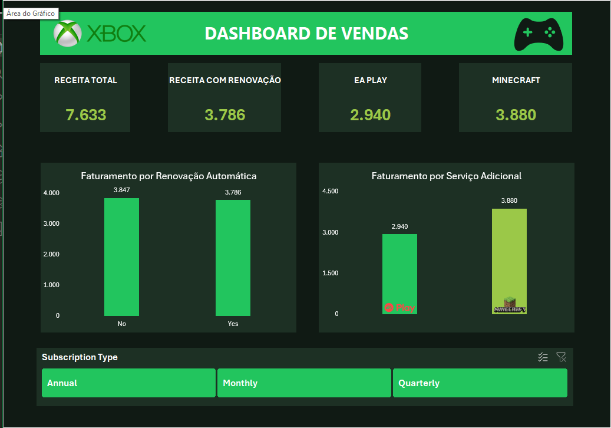

# 🎮 Dashboard de Vendas Xbox

Dashboard interativo desenvolvido no **Microsoft Excel**, como parte do desafio **Criando um Dashboard de Vendas do Xbox**, da formação **Santander Excel 2026**, disponibilizada pela [DIO](https://www.dio.me/).

O projeto tem como objetivo transformar dados de assinaturas e vendas de serviços Xbox em informações visuais, facilitando o acompanhamento de indicadores e a análise do faturamento.

## 📊 Visualização do Dashboard



## 🎯 Objetivo do Projeto

Desenvolver um dashboard funcional e interativo no Excel, utilizando uma base de dados de assinaturas para responder a perguntas de negócio e apresentar indicadores de faturamento.

Além das análises, o projeto busca aplicar boas práticas de organização, visualização de dados e experiência do usuário.

## 🛠️ Ferramentas e Recursos

- Microsoft Excel
- Tabelas Dinâmicas
- Gráficos Dinâmicos e gráficos vinculados a tabelas auxiliares
- Segmentação de Dados (Slicers)
- Função `INFODADOSTABELADINÂMICA`
- Formatação personalizada
- Proteção de planilhas
- Git e GitHub
- Visual Studio Code

## 📂 Estrutura do Projeto

```text
dashboard-vendas-xbox/
│
├── images/
│   └── dashboard-preview.png
│
├── Dashboard_Vendas_Xbox.xlsx
│
└── README.md
```

O arquivo Excel contém quatro abas:

| Aba | Descrição |
|---|---|
| Assets | Recursos visuais e identidade visual |
| Bases | Base original com 295 registros de assinaturas |
| Cálculos | Tabelas Dinâmicas e cálculos auxiliares |
| Dashboard | Painel visual e interativo |

As abas auxiliares foram ocultadas na versão de apresentação para proporcionar uma experiência mais limpa.

## 📈 Indicadores do Dashboard

O painel apresenta quatro indicadores principais:

| Indicador | Valor Geral |
|---|---:|
| Receita Total | 7.633 |
| Receita com Renovação Automática | 3.786 |
| Faturamento EA Play | 2.940 |
| Faturamento Minecraft | 3.880 |

Os valores representam os montantes registrados na base de dados disponibilizada para o desafio.

**Observação:** os valores de EA Play e Minecraft compõem os registros financeiros analisados e não devem ser somados novamente à Receita Total.

## 📉 Análises Desenvolvidas

### 1. Faturamento por Renovação Automática

Comparação entre assinantes que possuem renovação automática habilitada e aqueles que não possuem.

- **No:** 3.847
- **Yes:** 3.786

### 2. Faturamento por Serviço Adicional

Análise dos valores associados aos serviços adicionais:

- **EA Play Season Pass:** 2.940
- **Minecraft Season Pass:** 3.880

## 🎛️ Interatividade

O dashboard possui uma Segmentação de Dados baseada no campo `Subscription Type`, permitindo filtrar os resultados por:

- Monthly
- Quarterly
- Annual

Ao selecionar uma opção, os indicadores e gráficos são atualizados automaticamente, permitindo análises específicas para cada periodicidade de assinatura.

Os cálculos utilizam a função `INFODADOSTABELADINÂMICA`, reduzindo a dependência de referências fixas às células das Tabelas Dinâmicas.

## 🎨 Identidade Visual

O dashboard foi desenvolvido com inspiração na identidade visual do Xbox, utilizando:

- Fundo verde-escuro
- Tons de verde nos indicadores e gráficos
- Ícones relacionados ao Xbox e aos serviços analisados
- Cartões de indicadores (KPIs)
- Segmentação de Dados personalizada

O objetivo foi criar uma interface visualmente organizada, intuitiva e de fácil leitura.

## 🔒 Proteção e Organização

A aba Dashboard foi protegida contra edições acidentais, mantendo a interação com os filtros.

As abas de apoio foram ocultadas, e a estrutura da pasta de trabalho foi protegida para preservar a organização do projeto.

## ▶️ Como Utilizar

1. Faça o download do arquivo `Dashboard_Vendas_Xbox.xlsx`.
2. Abra o arquivo no Microsoft Excel.
3. Visualize os indicadores e gráficos na aba Dashboard.
4. Utilize o filtro `Subscription Type` para selecionar a periodicidade desejada.
5. Limpe o filtro para retornar à visão geral dos dados.

Para preservar os elementos interativos e a formatação, recomenda-se utilizar a versão desktop do Microsoft Excel.

## 📚 Aprendizados

Durante o desenvolvimento deste projeto, foram praticados conceitos de:

- Análise e organização de dados
- Construção de Tabelas Dinâmicas
- Criação e personalização de gráficos
- Indicadores de desempenho (KPIs)
- Conexões entre Segmentações de Dados e Tabelas Dinâmicas
- Referências dinâmicas para consultas de valores
- Design e usabilidade de dashboards
- Proteção e apresentação de planilhas
- Documentação de projetos no GitHub

## 🚀 Desafio DIO

**Formação:** Santander Excel 2026

**Projeto:** Criando um Dashboard de Vendas do Xbox

**Plataforma:** [Digital Innovation One — DIO](https://www.dio.me/)

## 👨‍💻 Autor

Desenvolvido por [MrLeandro357](https://github.com/MrLeandro357) como parte dos estudos em Excel, análise de dados e desenvolvimento de soluções para visualização de informações.